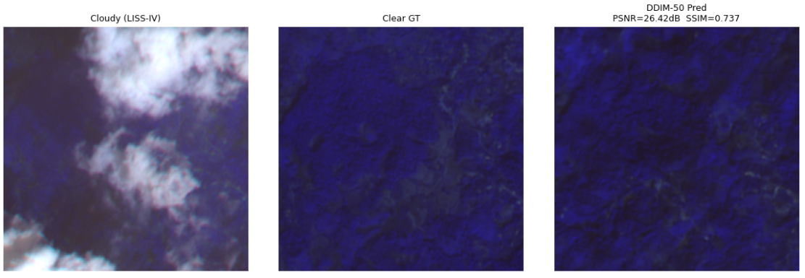

# SAR-Optical Cloud Removal Diffusion

A diffusion-based framework for removing cloud cover from optical satellite imagery, guided by co-registered SAR (Synthetic Aperture Radar) observations. The model is built around the OS-MambaDiff architecture, which fuses optical and SAR modalities through a Mamba-based state-space backbone inside a denoising diffusion process, and is trained and evaluated on LISS-IV optical imagery.

## Overview

Optical satellite imagery is frequently obscured by cloud cover, which limits its usefulness for continuous land monitoring. SAR sensors can see through clouds but lack the spectral detail of optical sensors. This project reconstructs cloud-free optical imagery by conditioning a diffusion model on the corresponding cloudy optical frame and its SAR counterpart, allowing the network to recover the surface detail that clouds obscure while remaining faithful to the true ground state captured by SAR.

The implementation follows the design described in the reference paper below, with a custom PyTorch training and inference pipeline for the LISS-IV dataset.

## Method

- **Diffusion backbone:** Denoising diffusion process with a sigmoid noise schedule and deterministic DDIM sampling for faster, stable inference.
- **Optical-SAR fusion:** SAR and optical inputs are fused through a Mamba-based state-space module, allowing the model to condition its predictions on structural information from SAR even where the optical signal is fully occluded by cloud.
- **Cloud-consistency loss:** A custom loss term penalizes predictions that stay too close to the cloudy input in regions where the optical and cloudy signals diverge, encouraging genuine cloud removal rather than pass-through of the input.
- **Sinusoidal timestep embeddings:** Standard DDPM-style time-step conditioning is used across the denoising network.
- **Preprocessing:** Optical DN values are scaled to a fixed range and clipped to [0, 1]; SAR data is converted from dB to linear power and normalized per-image before being passed to the network.

## Dataset

- **Optical:** LISS-IV multispectral imagery (cloudy and clear pairs)
- **SAR:** Co-registered SAR imagery used as a cloud-penetrating conditioning signal
- Data is read and processed with `rasterio`, with paired cloudy/clear/SAR samples organized into train and validation splits.

## Results

Evaluated on held-out LISS-IV test pairs using DDIM sampling (50 steps):

| Metric | Value |
|---|---|
| PSNR | 26.73 dB |
| SSIM | 0.79 |
| SAM  | 4.93 |

**PSNR** (Peak Signal-to-Noise Ratio) measures overall reconstruction fidelity, **SSIM** (Structural Similarity Index) measures how well spatial structure and texture are preserved, and **SAM** (Spectral Angle Mapper, in degrees) measures spectral consistency between the predicted and ground-truth reflectance — lower is better for SAM.

### Sample Reconstructions

The model recovers ground surface structure that is fully obscured by cloud in the input, guided by the SAR conditioning signal, with reconstruction quality improving substantially as cloud cover in the input decreases.

## Tech Stack

- Python, PyTorch
- rasterio (satellite raster I/O)
- NumPy, Matplotlib
- Diffusion models (DDPM / DDIM), Mamba state-space modeling

## How It Works

1. Load paired cloudy optical, clear optical, and SAR rasters for each training tile.
2. Normalize optical imagery to [0, 1] and SAR imagery to linear power, per-image min-max scaled.
3. Train the diffusion model to predict the clear optical image conditioned on the cloudy optical and SAR inputs, using a combination of the standard diffusion objective and the cloud-consistency loss.
4. At inference, run DDIM sampling (50 steps) to reconstruct the cloud-free image from the trained model.
5. Evaluate reconstructions against ground truth using PSNR, SSIM, and SAM.

## Reference

[1] "An Optical-SAR Fusion Diffusion Framework With Mamba for Robust Cloud Removal in Remote Sensing Imagery," IEEE Xplore, 2025. Available: https://ieeexplore.ieee.org/document/11432869
